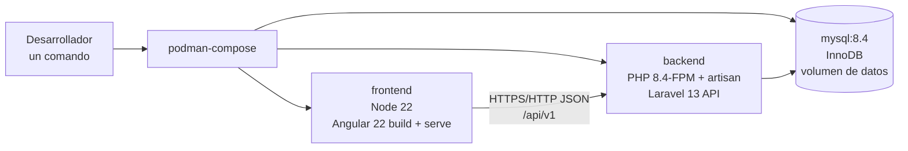
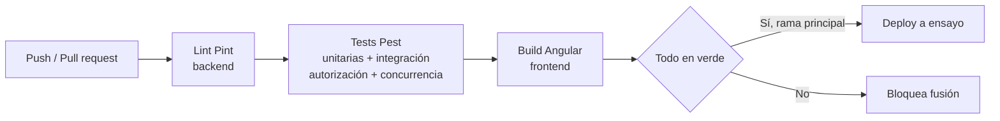

# Arquitectura de despliegue - Shadow-Net StockFlow

**Estado del documento:** v1.0 (planificación). **Fecha:** 10/10/2026. **Autor:** Shadow-Net Technologies.

Este documento describe cómo se construye, se prueba, se despliega y se opera el ERP Shadow-Net StockFlow: servicios de contenedores, entornos, integración continua, secretos, respaldos y observabilidad. La visión del sistema está en [system-architecture.md](./system-architecture.md), las decisiones de entorno en [architecture-decisions.md](./architecture-decisions.md) (ADR-017 y ADR-006), el backend en [backend-architecture.md](./backend-architecture.md) y el frontend en [frontend-architecture.md](./frontend-architecture.md). El acta del proyecto está en [../planning/project-charter.md](../planning/project-charter.md).

## 1. Principios

- Podman con podman-compose como entorno canónico y reproducible, sin necesidad de un demonio en segundo plano: el desarrollo puede hacerse en el host, pero la referencia es el contenedor. [DECISIÓN]
- Un solo comando documentado levanta todo el sistema (criterio CG-04 del acta).
- Imágenes ligeras y límites de recursos explícitos por la restricción de memoria del equipo local (riesgo R-10 del acta). [DECISIÓN]
- Secretos solo por variables de entorno; nunca confirmados en el repositorio.
- La integración continua ejecuta estilo, pruebas y construcción antes de cualquier despliegue.

Versiones aplicables (ver [architecture-decisions.md](./architecture-decisions.md)): Podman 5.4.2 con Buildah 1.39.3 y podman-compose 1.6.0 (instalado vía pipx), MySQL 8.4 LTS (8.4.11), PHP 8.4.x con Laravel 13.35.x, Node 22 LTS o 24 LTS para Angular 22.2.x. Docker 26.1.5 sigue instalado en el host pero su demonio está apagado y no se usa.

## 2. Servicios de `compose.yaml` (podman-compose)



| Servicio | Imagen base | Función |
| --- | --- | --- |
| `mysql` | MySQL 8.4 LTS oficial | Base de datos InnoDB con volumen persistente; juego de caracteres `utf8mb4`; usuario y contraseña por variables de entorno. |
| `backend` | PHP 8.4 con extensiones (`pdo_mysql`, `mbstring`, `intl`, `zip`) más Composer para instalación | Sirve la API (`php artisan serve` en desarrollo o PHP-FPM tras servidor web en ensayo), ejecuta migraciones, semillas y la cola de base de datos (`queue:work`). |
| `frontend` | Node 22 LTS | Instala dependencias, construye la SPA (`ng build`) y la sirve en desarrollo (`ng serve`) o como estáticos en ensayo. |

Esqueleto ilustrativo de la composición (sin valores secretos):

```yaml
services: # ver compose.yaml (esqueleto)
  mysql:
    image: docker.io/library/mysql:8.4 # nombre de registro completo: Podman no resuelve nombres cortos
    environment:
      MYSQL_DATABASE: ${DB_DATABASE}
      MYSQL_USER: ${DB_USERNAME}
      MYSQL_PASSWORD: ${DB_PASSWORD}
      MYSQL_ROOT_PASSWORD: ${DB_ROOT_PASSWORD}
    volumes:
      - mysql-data:/var/lib/mysql
  backend:
    build: ./backend
    depends_on: [mysql]
    environment:
      DB_HOST: mysql
      APP_KEY: ${APP_KEY}
  frontend:
    build: ./frontend
    depends_on: [backend]
volumes:
  mysql-data:
```

## 3. Imágenes OCI construidas por Buildah (Dockerfiles)

- `backend/Dockerfile`: parte de una imagen PHP 8.4 ligera, instala solo las extensiones necesarias, copia `composer.json` primero para aprovechar la caché de capas, instala dependencias sin paquetes de desarrollo en la imagen de ensayo y fija permisos del almacenamiento de Laravel. [DECISIÓN]
- `frontend/Dockerfile`: usa Node 22 LTS en una etapa de construcción para compilar Angular y sirve los estáticos resultantes; en desarrollo monta el código como volumen para recarga en caliente. Se evita cualquier imagen con navegadores o herramientas pesadas para respetar la memoria disponible. [DECISIÓN]

## 4. Entornos local, ensayo y producción

| Aspecto | Local | Ensayo (staging) | Producción |
| --- | --- | --- | --- |
| Propósito | Desarrollo diario y pruebas de concurrencia contra MySQL real | Verificación previa al pase con datos de prueba | Operación real |
| Composición | `podman-compose up -d` con volúmenes de código | Construcción limpia sin volúmenes de código; imagen versionada | Imagen versionada e inmutable; migraciones aplicadas por paso controlado |
| Base de datos | Contenedor MySQL con volumen local | Instancia separada; restaurable desde respaldo | Instancia gestionada o dedicada; respaldos programados |
| Configuración | Fichero `.env` local no confirmado | Variables del entorno de ensayo | Variables del gestor de secretos del proveedor |
| Frontend | `ng serve` o estáticos locales con `apiBaseUrl` al backend local | Estáticos construidos con el `environment.staging` | Estáticos construidos con el `environment.prod` |

[DECISIÓN] La promoción entre entornos mueve imágenes versionadas, nunca código sin construir; las migraciones se ejecutan de forma explícita (`php artisan migrate --force`) y auditada en ensayo y producción.

## 5. Integración continua y despliegue con GitHub Actions

[DECISIÓN] El flujo de GitHub Actions tiene dos etapas: integración (CI) obligatoria en cada rama y despliegue (deploy) solo desde la rama principal tras el éxito de la integración.



- `lint (Pint)`: verifica el estilo del backend con Pint 1.32.x; falla si hay diferencias.
- `tests (Pest)`: ejecuta la suite Pest 5.3.x contra un servicio MySQL 8.4 real (las pruebas de concurrencia exigen bloqueo de filas InnoDB; SQLite está descartado según las decisiones).
- `build (Angular)`: instala con Node 22 LTS y compila la SPA; falla ante errores de tipado estricto.
- `deploy`: etapa separada que construye las imágenes versionadas, las publica en el registro y las despliega en el entorno de ensayo; la producción se despliega por aprobación manual tras validar el ensayo.
- El flujo usa setup-php y setup-node sobre corredores alojados por GitHub, con su propio soporte de contenedores: no depende de un demonio Docker local ni ejecuta Podman.

## 6. Secretos y configuración

[DECISIÓN] Todos los secretos viajan por variables de entorno y nunca se confirman:

- Backend: `APP_KEY`, credenciales de base de datos (`DB_*`), credenciales del administrador de desarrollo en semillas, credenciales de correo y del registro de imágenes.
- Origen de la SPA: la variable `FRONTEND_URL` fija el origen autorizado a llamar a la API con la cookie de sesión (la lee `backend/config/cors.php`) y debe figurar además en `SANCTUM_STATEFUL_DOMAINS`. Sin ella el navegador bloquea toda petición con credenciales, porque la SPA se autentica por cookie y no por token (C-06).
- Frontend: solo configuración pública (`apiBaseUrl` por environment); ningún secreto en el paquete compilado.
- Repositorio: los ficheros `.env` y cualquier fichero con secretos están en `.gitignore`; el repositorio solo contiene `.env.example` con valores ficticios y la lista de variables requeridas.
- CI: los secretos viven en los secretos del repositorio o del entorno de GitHub Actions, nunca en el flujo versionado.

## 7. Respaldos de base de datos

- Respaldo lógico programado de MySQL (`mysqldump` o equivalente) con retención documentada; el kardex y la auditoría son inmutables y su pérdida no es reconstruible desde otro origen.
- Procedimiento de restauración probado en ensayo antes de declararlo válido; la verificación de la invariante kardex-saldo (consulta de [database-design.md](./database-design.md), §9) se ejecuta tras cada restauración.
- Los respaldos se cifran en reposo y su acceso se registra; contienen datos operativos reales.

## 8. Registros y observabilidad

- Backend: registros estructurados de Laravel por canal y nivel (peticiones con identificador de correlación, errores de negocio con contexto, trabajos de cola y exportaciones); los errores 500 exponen solo el identificador al cliente.
- Base de datos: registro de errores de MySQL y alertas de espacio del volumen de datos.
- Frontend: captura de errores de la SPA con el identificador de correlación del backend para trazar una operación de extremo a extremo.
- Integración continua: historial de ejecuciones como evidencia de calidad (estilo, pruebas y construcción en verde por confirmación).

## 9. Instalación reproducible con un comando

[DECISIÓN] El procedimiento canónico local es:

1. Copiar `.env.example` a `.env` y completar las variables requeridas.
2. Ejecutar `podman-compose up -d --build`.
3. Aplicar migraciones y semillas con `podman-compose exec -T backend php artisan migrate --force`.
4. Abrir la SPA en la URL documentada y verificar el indicador de salud de la API.

Este procedimiento satisface el criterio CG-04 del acta y se mantiene probado en integración continua. La consideración de hardware limitado (riesgo R-10) obliga a documentar los requisitos mínimos, a fijar límites de memoria por servicio en la composición y a preferir imágenes ligeras; si la construcción del frontend excede la memoria local, la construcción se traslada al flujo de CI y el equipo local consume el artefacto resultante.

## 10. Referencias

- Sistema: [system-architecture.md](./system-architecture.md).
- Decisiones: [architecture-decisions.md](./architecture-decisions.md).
- Backend: [backend-architecture.md](./backend-architecture.md).
- Frontend: [frontend-architecture.md](./frontend-architecture.md).
- Dominio: [inventory-domain.md](./inventory-domain.md).
- Datos: [database-design.md](./database-design.md) y [er-diagram.md](./er-diagram.md).
