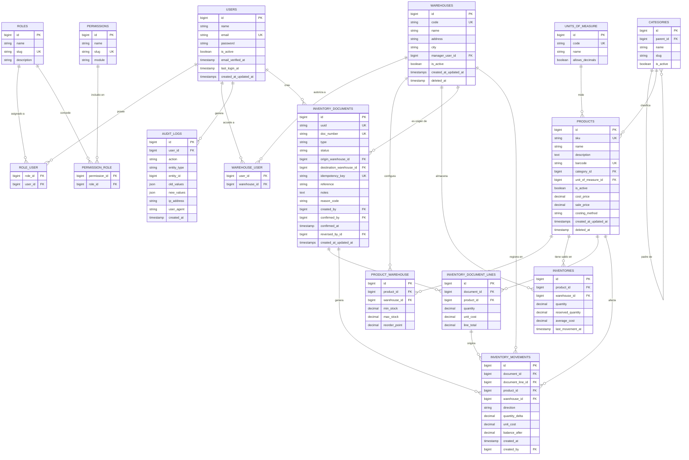

# Diagrama entidad-relación - Shadow-Net StockFlow

**Estado del documento:** v1.0 (planificación). **Fecha:** 10/10/2026. **Autor:** Shadow-Net Technologies.

Este documento presenta el modelo entidad-relación del MVP en Mermaid, con sus cardinalidades y una explicación breve de cada relación. El detalle de columnas, tipos, restricciones e índices vive en [database-design.md](./database-design.md). Las reglas del núcleo de inventario están en [inventory-domain.md](./inventory-domain.md).

## 1. Diagrama entidad-relación

## 2. Cardinalidades

| Relación | Cardinalidad | Descripción |
| --- | --- | --- |
| users - role_user - roles | N:M | Un usuario puede tener varios roles; un rol agrupa varios usuarios. |
| roles - permission_role - permissions | N:M | Un rol concede varios permisos; un permiso pertenece a varios roles. |
| users - warehouse_user - warehouses | N:M | Un usuario accede a varios almacenes; un almacén autoriza a varios usuarios. |
| categories - categories | 1:N (autorreferente) | Una categoría padre tiene varias hijas; jerarquía de profundidad acotada. |
| categories - products | 1:N | Una categoría agrupa varios productos. |
| units_of_measure - products | 1:N | Una unidad de medida se usa en varios productos. |
| products - product_warehouse - warehouses | N:M | Configuración de stock mínimo/máximo por producto y almacén. |
| products - inventories - warehouses | N:M (tabla puente con saldo) | Un producto tiene un saldo por cada almacén. Restricción única `(product_id, warehouse_id)`. |
| warehouses - inventory_documents (origen) | 1:N | Un almacén es origen de varios documentos. |
| warehouses - inventory_documents (destino) | 1:N | Un almacén es destino de varias transferencias. |
| inventory_documents - inventory_document_lines | 1:N | Un documento contiene una o varias líneas. |
| inventory_documents - inventory_movements | 1:N | Un documento confirmado genera uno o varios movimientos. |
| inventory_document_lines - inventory_movements | 1:N | Una línea origina al menos un movimiento (dos en transferencias). |
| products - inventory_movements | 1:N | Un producto aparece en muchos movimientos (kardex). |
| warehouses - inventory_movements | 1:N | Un almacén registra muchos movimientos. |
| users - audit_logs | 1:N | Un usuario genera muchas entradas de auditoría. |

## 3. Notas de modelado

- **Inventario como libro + saldo.** `inventory_movements` es el libro inmutable (append-only); `inventories` es el saldo materializado por rendimiento. Su coherencia es la invariante I-02 de [inventory-domain.md](./inventory-domain.md).
- **Documento, línea y movimiento.** La intención de negocio (`inventory_documents` + `inventory_document_lines`) se separa del efecto (`inventory_movements`), lo que permite estados `borrador`/`confirmado` y reversiones trazables.
- **Transferencias.** Un documento de tipo `transferencia` usa `origin_warehouse_id` y `destination_warehouse_id` y genera dos movimientos por línea (uno de salida en origen y uno de entrada en destino).
- **Unicidad.** Cada tabla con nombre lógico único lo garantiza con restricción `UNIQUE`: `warehouses.code`, `products.sku`, `products.barcode` (cuando no es nulo), `inventory_documents.uuid`, `inventory_documents.doc_number`, `inventory_documents.idempotency_key` y `inventories(product_id, warehouse_id)`.
- **Borrado lógico.** `warehouses` y `products` usan desactivación (`is_active`) y borrado lógico (`deleted_at`); nunca se borran físicamente si tienen movimientos, para preservar el kardex.
- **Sin secretos.** `users.password` se guarda con hash; `audit_logs` nunca almacena contraseñas, tokens ni secretos.
- **Evolución multi-organización.** El diagrama no incluye `organization_id` en el MVP; se añadirá como columna discriminante en V2 sin rehacer relaciones.
