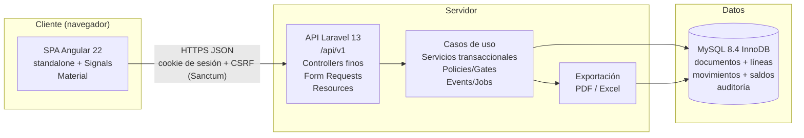

# Arquitectura del sistema - Shadow-Net StockFlow

**Estado del documento:** v1.0 (planificación). **Fecha:** 10/10/2026. **Autor:** Shadow-Net Technologies.

Este documento describe la arquitectura general del ERP Shadow-Net StockFlow: sus componentes, responsabilidades, patrones, flujo de petición de extremo a extremo y organización del repositorio. El detalle del dominio de inventario está en [inventory-domain.md](./inventory-domain.md), las decisiones registradas en [architecture-decisions.md](./architecture-decisions.md), el modelo físico en [database-design.md](./database-design.md) y el diagrama de entidades en [er-diagram.md](./er-diagram.md). El acta del proyecto está en [../planning/project-charter.md](../planning/project-charter.md). Los detalles de implementación por capa se amplían en [backend-architecture.md](./backend-architecture.md), [frontend-architecture.md](./frontend-architecture.md) y [deployment-architecture.md](./deployment-architecture.md).

## 1. Visión general

Shadow-Net StockFlow es una aplicación web ERP multi-almacén con separación cliente-servidor y contrato API-first. [DECISIÓN]

- El cliente es una SPA Angular que no contiene reglas de negocio del inventario; solo presenta datos, captura entradas y mejora la experiencia de uso.
- El servidor es una API REST monolítica modular en Laravel que concentra todas las reglas del dominio, la autorización y la integridad transaccional.
- La base de datos MySQL con InnoDB es la fuente de verdad: kardex inmutable, saldo materializado y auditoría.

Regla permanente heredada del dominio: ninguna interfaz protege el inventario; solo el backend lo hace (ver [inventory-domain.md](./inventory-domain.md)).

## 2. Componentes y responsabilidades

| Componente | Tecnología | Responsabilidad |
| --- | --- | --- |
| SPA de gestión | Angular 22.2.x (ver [architecture-decisions.md](./architecture-decisions.md), ADR-006) | Componentes standalone, estado local con Signals, formularios reactivos, navegación por rutas, consumo de la API v1 mediante servicios. No valida autorización ni disponibilidad de stock; solo presenta los errores del backend. |
| API de negocio | Laravel 13.35.x sobre PHP 8.4.x (ADR-002) | Rutas versionadas `/api/v1`, controladores finos, Form Requests, casos de uso transaccionales, Policies y Gates (RBAC nativo, ADR-004), recursos de respuesta, eventos y trabajos en cola de base de datos (ADR-013). Autenticación con Sanctum 4.3.x (ADR-003). |
| Base de datos | MySQL 8.4 LTS con InnoDB (ADR-005) | Transacciones ACID, integridad referencial, bloqueo pesimista de filas, restricciones UNIQUE y CHECK. Tablas documento-línea-movimiento, saldo materializado y auditoría. |
| Contrato de API | Especificación OpenAPI versionada (ADR-012) | Contrato único entre frontend y backend; base para documentación servida y futuros clientes o simuladores. |
| Exportación | `barryvdh/laravel-dompdf` 3.1.x y `maatwebsite/excel` 4.0.x (ADR-015) | Generación de reportes PDF y Excel en el backend, bajo las mismas reglas de autorización. |
| Entorno y despliegue | Podman con podman-compose (ADR-017) | Servicios MySQL, backend y frontend reproducibles con un solo comando, sin demonio. Detalle en [deployment-architecture.md](./deployment-architecture.md). |

## 3. Diagrama de componentes



Descripción del diagrama: el navegador solo habla con la API por HTTPS y JSON; la API delega en casos de uso que ejecutan la transacción contra MySQL; la exportación es un módulo del backend que lee los mismos datos bajo autorización.

## 4. Diagrama de secuencia del flujo completo de una operación de inventario

El siguiente diagrama muestra la confirmación de un documento (entrada, salida, ajuste o transferencia) desde la interfaz hasta la base de datos y de vuelta.

```mermaid
sequenceDiagram
    actor Usuario
    participant C as Component (standalone)
    participant S as Angular service
    participant I as HTTP interceptor
    participant R as Laravel route /api/v1
    participant FR as Form Request
    participant CT as Controller (fino)
    participant UC as Use-case service
    participant DB as MySQL (transacción + lock)
    participant AR as API Resource
    Usuario->>C: Registra operación (formulario reactivo)
    C->>S: Invoca método (p. ej. confirmDocument(payload, idempotencyKey))
    S->>I: Petición HTTP + clave de idempotencia
    I->>R: Añade credenciales/CSRF y gestión centralizada de errores
    R->>FR: Despacha a ruta versionada con middleware auth + autorización
    FR->>CT: Validación sintáctica superada (tipos, requeridos, formatos)
    CT->>UC: Delega en caso de uso con datos validados y usuario autenticado
    UC->>DB: BEGIN; bloquea filas inventories con SELECT ... FOR UPDATE en orden (warehouse_id, product_id)
    DB-->>UC: Filas bloqueadas (o fila creada con reintento ante UNIQUE)
    UC->>DB: Valida reglas (estado borrador, disponibilidad, almacenes, motivo); aplica deltas; inserta movimientos; actualiza documento a confirmado; inserta auditoría
    DB-->>UC: COMMIT (o ROLLBACK ante cualquier fallo)
    UC-->>CT: Resultado de dominio (documento confirmado o error de negocio)
    CT->>AR: Transforma a JSON versionado
    AR-->>S: Respuesta HTTP (recurso o error mapeado con código)
    S-->>C: Entrega datos tipados
    C->>C: Actualiza Signals; computed recalcula derivados (totales, saldos)
```

## 5. Narrativa del flujo de petición

1. El componente standalone recoge la intención del usuario con un formulario reactivo y validación de presentación (formatos, campos requeridos). Esta validación es cosmética; no otorga derechos ni garantiza disponibilidad.
2. El servicio Angular construye la petición JSON contra `apiBaseUrl` más `/api/v1/...`, genera o reutiliza la clave de idempotencia del documento y la envía en la cabecera o el cuerpo según el contrato OpenAPI.
3. El interceptor funcional añade las credenciales de sesión y el token CSRF de Sanctum, y centraliza el manejo de errores HTTP (sesión expirada, validación 422, negocio 409/422, servidor 500) para que los componentes reciban errores tipados.
4. La ruta `routes/api/v1/...` aplica los middlewares de autenticación y expone solo la versión 1; el versionado permite evolucionar sin romper el cliente.
5. El Form Request valida la sintaxis (tipos, rangos, existencia de identificadores) y la autorización gruesa se verifica con Policies y Gates antes de tocar el dominio.
6. El controlador fino traduce HTTP a una llamada al caso de uso; no abre transacciones ni calcula costos.
7. El servicio de caso de uso ejecuta la unidad atómica descrita en [inventory-domain.md](./inventory-domain.md) (§5): revalida el estado en modo bloqueante, adquiere los bloqueos `SELECT ... FOR UPDATE` en orden ascendente por `(warehouse_id, product_id)`, valida las reglas de negocio contra el saldo bloqueado, aplica los deltas a `inventories`, inserta los movimientos del kardex con el saldo resultante, recalcula el promedio ponderado cuando corresponde, cambia el estado del documento y registra la auditoría. Todo dentro de una transacción con reintento acotado ante interbloqueo.
8. Ante cualquier fallo (stock insuficiente, documento ya confirmado, clave de idempotencia duplicada, fila inactiva), el servicio aborta con una excepción de dominio que el manejador de excepciones mapea a un código HTTP y un cuerpo de error uniforme.
9. El API Resource serializa el resultado con la forma pública estable (identificador `uuid` para documentos, nunca el id interno) y el cliente actualiza sus Signals; los valores derivados (`computed`) se recalculan sin intervención manual.

## 6. Patrones empleados y justificación

| Patrón | Dónde | Justificación |
| --- | --- | --- |
| Monolito modular API-first [DECISIÓN] | Sistema completo (ADR-001) | Un solo desarrollador puede construir, probar y desplegar el MVP; las transacciones locales del inventario son simples dentro de un monolito y no requieren coordinación distribuida. La modularidad interna permite extraer servicios en el futuro sin pagar hoy el costo operativo de microservicios. |
| Backend por capas [DECISIÓN] | HTTP, casos de uso, dominio, acceso a datos (detalle en [backend-architecture.md](./backend-architecture.md)) | Separa la traducción HTTP de la lógica transaccional y del acceso a datos; las reglas se prueban sin HTTP y se reutilizan desde consola o cola. |
| Servicio / caso de uso [DECISIÓN] | Confirmación, reversión, creación de documentos | Concentra la transacción y las reglas RN-INV en un solo lugar auditable; el controlador queda fino y el dominio queda independiente del transporte. |
| Repositorio o modelos Eloquent [DECISIÓN] | Acceso a datos del MVP | Se usan los modelos Eloquent como puerta de acceso en el MVP por simplicidad y por ser la convención de Laravel; si el acceso a datos se complica (consultas de kardex, valorización), se introduce una capa de repositorios sin cambiar los casos de uso. |
| DTO y Resources [DECISIÓN] | Entrada (Form Requests y objetos de datos) y salida (API Resources) | Los Form Requests validan la sintaxis en el borde; los Resources fijan el contrato JSON versionado y ocultan columnas internas. Ambos protegen al dominio de cambios en el transporte. |
| Libro documento-línea-movimiento [DECISIÓN] | Dominio de inventario (ADR-008) | Separa la intención de negocio del efecto sobre existencias; habilita estados, kardex consultable, reversiones y auditoría. La alternativa de actualizar una columna pierde trazabilidad. |
| Bloqueo pesimista ordenado [DECISIÓN] | Concurrencia (ADR-009) | `SELECT ... FOR UPDATE` en orden consistente por `(warehouse_id, product_id)` serializa operaciones sobre el mismo par producto-almacén con garantías fáciles de razonar; el reintento acotado absorbe interbloqueos transitorios. |
| Idempotencia por clave única [DECISIÓN] | Creación y confirmación | La restricción UNIQUE sobre `idempotency_key` es la garantía dura contra duplicados por reintentos de red; el servicio devuelve el resultado existente sin reaplicar efectos. |

## 7. Organización de carpetas en la raíz del repositorio

[DECISIÓN] Monorepo documentación-primero con tres directorios de primer nivel (ADR-016):

```text
shadownet-stockflow/
  docs/                    Especificación canónica (planificación, arquitectura, desarrollo).
    planning/              Acta, requisitos, alcance y planificación.
    architecture/          Este documento y sus complementos (dominio, decisiones,
                           base de datos, diagrama ER, backend, frontend, despliegue).
    development/           Flujo de trabajo, estrategia de pruebas, estándares.
  backend/                 Aplicación Laravel 13 (API /api/v1). Se crea en fases posteriores.
  frontend/                Aplicación Angular 22 (SPA). Se crea en fases posteriores.
```

En la fase actual solo existe `docs/`; `backend/` y `frontend/` se crean en las fases de implementación según la secuencia de entrega. El detalle de ramas, confirmaciones y flujo de trabajo vive en la documentación de desarrollo.

## 8. Decisiones descartadas

El registro completo con contexto y consecuencias está en [architecture-decisions.md](./architecture-decisions.md) (§4). Resumen aplicable a este nivel:

- Microservicios: descartados por complejidad operativa y por romper las transacciones locales del inventario.
- Kubernetes: sobredimensionado para el MVP; prohibido por la regla de no introducir infraestructura por moda.
- Redis: no se justifica con el volumen del MVP; se usa la cola de base de datos de Laravel.
- Event sourcing: complejidad conceptual alta; el libro de movimientos ya aporta trazabilidad suficiente.
- FIFO en el MVP: requiere capas de costo; sin lotes no aporta valor proporcional frente al promedio ponderado.
- Autenticación JWT pura y Fortify completo: se adopta Sanctum con sesión por cookie para la SPA y tokens con habilidades para integraciones futuras.
- SQLite para pruebas de concurrencia: no reproduce el bloqueo de filas de InnoDB; las pruebas de concurrencia exigen MySQL real.

## 9. Referencias

- Dominio: [inventory-domain.md](./inventory-domain.md).
- Decisiones: [architecture-decisions.md](./architecture-decisions.md).
- Datos: [database-design.md](./database-design.md) y [er-diagram.md](./er-diagram.md).
- Backend: [backend-architecture.md](./backend-architecture.md).
- Frontend: [frontend-architecture.md](./frontend-architecture.md).
- Despliegue: [deployment-architecture.md](./deployment-architecture.md).
- Proyecto: [../planning/project-charter.md](../planning/project-charter.md).
