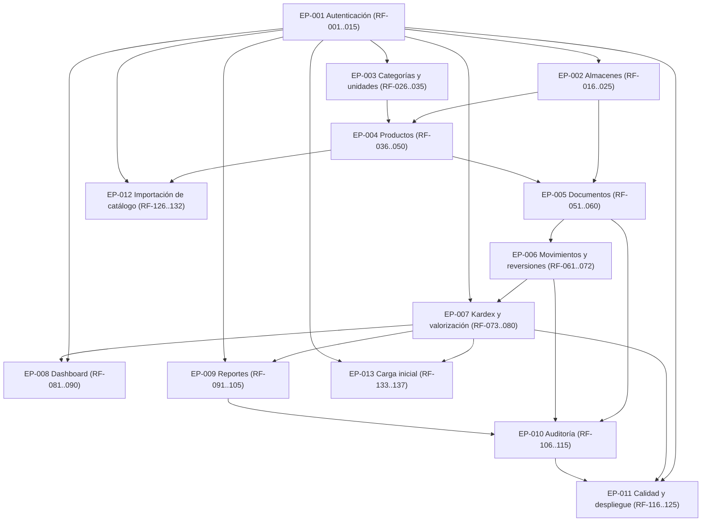

# Backlog del producto - Shadow-Net StockFlow

**Estado del documento:** v1.0 (planificación). **Fecha:** 10/10/2026. **Autor:** Shadow-Net Technologies.

Este documento ordena el trabajo del MVP en épicas con sus rangos de requisitos, tareas técnicas, dependencias y prioridad. El detalle de cada requisito vive en [requirements.md](./requirements.md): aquí no se duplica el texto de los RF, solo se referencia su rango. La secuencia de fases está en [scope-and-milestones.md](./scope-and-milestones.md) y las reglas del inventario en [../architecture/inventory-domain.md](../architecture/inventory-domain.md). Las duraciones y esfuerzos son [ESTIMACIÓN] Fuente: juicio del equipo de planificación.

Convención de este backlog: cada épica implementa el rango de RF indicado; la aceptación remite a los criterios de requirements.md y a las historias de usuario del módulo correspondiente (definidas en requirements.md), sin inventar identificadores nuevos.

## EP-001. Autenticación y control de acceso (RF-001 a RF-015)

- **Módulo:** Autenticación. **Prioridad:** Must (MVP, Fase 1).
- **Tareas técnicas:** endpoints de login, logout y perfil con Sanctum estatal para la SPA según ADR-003; RBAC nativo con tablas `roles`, `permissions`, `role_user` y `permission_role` más Gates y Policies según ADR-004; pivote `warehouse_user` para el alcance por almacén; semillas de roles base y permisos por módulo; interceptores Angular para sesión, CSRF y errores.
- **Dependencias:** Fase 0 (esqueleto, base de datos, CI). Sin dependencias de negocio.
- **Referencia de aceptación:** criterios de los RF-001 a RF-015 en requirements.md y las historias de usuario del módulo Autenticación (definidas en requirements.md).

## EP-002. Gestión de almacenes (RF-016 a RF-025)

- **Módulo:** Almacenes. **Prioridad:** Must (MVP, Fase 1).
- **Tareas técnicas:** migraciones de `warehouses` y `warehouse_user` con código único y desactivación lógica según docs/architecture/database-design.md §5.1; CRUD con validación en el servidor; asignación y revocación de usuarios autorizados por almacén; responsable mediante `manager_user_id`; filtros y paginación en listados.
- **Dependencias:** EP-001 (toda operación de almacén exige autorización por rol y alcance).
- **Referencia de aceptación:** criterios de los RF-016 a RF-025 en requirements.md y las historias de usuario del módulo Almacenes (definidas en requirements.md).

## EP-003. Categorías y unidades de medida (RF-026 a RF-035)

- **Módulo:** Categorías y unidades. **Prioridad:** Must (MVP, Fase 2).
- **Tareas técnicas:** migraciones de `categories` (jerarquía con `parent_id`) y `units_of_measure` (código único, indicador de decimales); validación contra ciclos jerárquicos y contra el borrado con productos vinculados; semillas de unidades base; CRUD protegidos por permisos.
- **Dependencias:** EP-001 (autorización). Sin dependencia de productos.
- **Referencia de aceptación:** criterios de los RF-026 a RF-035 en requirements.md y las historias de usuario del módulo Categorías y unidades (definidas en requirements.md).

## EP-004. Gestión de productos (RF-036 a RF-050)

- **Módulo:** Productos. **Prioridad:** Must (MVP, Fase 2).
- **Tareas técnicas:** migración de `products` con SKU único, código de barras único opcional, DECIMAL para costos y precios, y método de costeo por defecto `promedio_ponderado`; migración de `product_warehouse` con stock mínimo, máximo y punto de reorden; desactivación y borrado lógico preservando el historial; búsqueda por SKU, nombre y código de barras con índices.
- **Dependencias:** EP-003 (categoría y unidad obligatorias por producto); EP-002 (configuración por almacén).
- **Referencia de aceptación:** criterios de los RF-036 a RF-050 en requirements.md y las historias de usuario del módulo Productos (definidas en requirements.md).

## EP-005. Documentos de inventario e idempotencia (RF-051 a RF-060)

- **Módulo:** Inventario. **Prioridad:** Must (MVP, Fase 3).
- **Tareas técnicas:** migraciones de `inventory_documents` (uuid público, número consecutivo, clave de idempotencia única, estados y motivos de ajuste) y `inventory_document_lines` (cantidad positiva, costo y total); máquina de estados `borrador`, `confirmado`, `revertido` y `descartado` solo en el servicio de dominio; validación de líneas mínimas y de almacenes distintos en transferencias; manejo idempotente del conflicto de clave duplicada.
- **Dependencias:** EP-002 y EP-004 (almacenes y productos activos); EP-001 (responsable y permisos de confirmación).
- **Referencia de aceptación:** criterios de los RF-051 a RF-060 en requirements.md y las historias de usuario del módulo Inventario (definidas en requirements.md).

## EP-006. Movimientos, transferencias y reversiones (RF-061 a RF-072)

- **Módulo:** Inventario. **Prioridad:** Must (MVP, Fase 3).
- **Tareas técnicas:** confirmación transaccional única que bloquea filas de `inventories` con `SELECT ... FOR UPDATE` en orden `(warehouse_id, product_id)` con reintento ante interbloqueos según ADR-009; generación de doble movimiento por línea de transferencia con atomicidad origen-destino; reversiones con movimientos compensatorios sin editar el original; rechazo de reversiones completas cuando el destino ya consumió parte (compensación por partes); pruebas de concurrencia C-01 a C-04 con MySQL real.
- **Dependencias:** EP-005 (documentos y líneas); EP-010 en paralelo para registrar la auditoría dentro de la misma transacción.
- **Referencia de aceptación:** criterios de los RF-061 a RF-072 en requirements.md y las historias de usuario del módulo Inventario (definidas en requirements.md).

## EP-007. Kardex, existencias y valorización (RF-073 a RF-080)

- **Módulo:** Inventario. **Prioridad:** Must (MVP, Fase 3).
- **Tareas técnicas:** tabla `inventory_movements` append-only sin `updated_at`; saldo materializado en `inventories` con restricción única por par producto-almacén; cálculo de promedio ponderado móvil con `average_cost` en `DECIMAL(18,6)`; consulta de kardex por producto, almacén y fecha con índices dedicados; verificación automatizada de las invariantes I-01 a I-07, incluida la consulta de coherencia kardex-saldo.
- **Dependencias:** EP-005 y EP-006 (los movimientos nacen de la confirmación).
- **Referencia de aceptación:** criterios de los RF-073 a RF-080 en requirements.md y las historias de usuario del módulo Inventario (definidas en requirements.md).

## EP-008. Dashboard operativo (RF-081 a RF-090)

- **Módulo:** Dashboard. **Prioridad:** Must (MVP, Fase 4).
- **Tareas técnicas:** endpoints agregados de productos activos, existencias por almacén, productos bajo stock mínimo, movimientos recientes y valorización; pantalla Angular con componentes standalone, Signals y `computed()` según ADR-014; guardias de ruta solo como ayuda de navegación; manejo uniforme de errores y estados de carga.
- **Dependencias:** EP-007 (existencias y valorización reales); EP-001 (alcance por almacén en cada indicador).
- **Referencia de aceptación:** criterios de los RF-081 a RF-090 en requirements.md y las historias de usuario del módulo Dashboard (definidas en requirements.md).

## EP-009. Reportes y exportación (RF-091 a RF-105)

- **Módulo:** Reportes. **Prioridad:** Must (MVP, Fase 5).
- **Tareas técnicas:** reportes de existencias por almacén, historial de movimientos y valorización con filtros y paginación; exportación a PDF y Excel en el backend según ADR-015; trabajos en colas de base de datos para exportaciones voluminosas según ADR-013; reutilización de las Policies de almacén en cada reporte.
- **Dependencias:** EP-007 (kardex y valorización); EP-001 (autorización por almacén).
- **Referencia de aceptación:** criterios de los RF-091 a RF-105 en requirements.md y las historias de usuario del módulo Reportes (definidas en requirements.md).

## EP-010. Auditoría y trazabilidad (RF-106 a RF-115)

- **Módulo:** Auditoría. **Prioridad:** Must (MVP, Fase 6).
- **Tareas técnicas:** migración de `audit_logs` sin borrado y sin campos secretos; escritura de la entrada de auditoría dentro de la transacción de negocio; visor de solo lectura para el rol Auditor; índices por usuario, entidad y fecha; revisión automatizada que rechaza secretos en valores registrados.
- **Dependencias:** EP-005 y EP-006 (operaciones auditables); EP-001 (roles, incluido el Auditor de solo lectura).
- **Referencia de aceptación:** criterios de los RF-106 a RF-115 en requirements.md y las historias de usuario del módulo Auditoría (definidas en requirements.md).

## EP-011. Calidad, pruebas y despliegue (RF-116 a RF-125)

- **Módulo:** Calidad. **Prioridad:** Must (MVP, Fases 0 y 7).
- **Tareas técnicas:** suite Pest con pruebas unitarias, de integración, de autorización y de concurrencia según ADR-010; pruebas de extremo a extremo de entrada, salida, transferencia y reversión; informe de cobertura; guía de despliegue reproducible con Podman (podman-compose) y un solo comando documentado; verificación de los criterios CG-01 a CG-06 del acta.
- **Dependencias:** todas las épicas anteriores (cierra el MVP); entorno de pruebas sobre MySQL real, nunca SQLite para concurrencia [DECISIÓN] Fuente: docs/architecture/architecture-decisions.md §ADR-005.
- **Referencia de aceptación:** criterios de los RF-116 a RF-125 en requirements.md y las historias de usuario del módulo Calidad (definidas en requirements.md).

## EP-012. Importación de catálogo (RF-126 a RF-132)

- **Módulo:** Importación de datos. **Prioridad:** Must (MVP, Fase 2).
- **Tareas técnicas:** descarga de plantilla XLSX y CSV con columnas esperadas y fila de ejemplo; validación previa en modo dry-run con informe por fila sin modificar datos; aplicación atómica e idempotente por SKU en una sola transacción; límites de tamaño, filas, tipo y codificación validados en el servidor; auditoría con autor, fecha, archivo y filas aplicadas; procesamiento en cola para archivos grandes.
- **Dependencias:** EP-003 y EP-004 (catálogo y productos); EP-001 (autorización con alcance por almacén donde aplique).
- **Referencia de aceptación:** criterios AC-061 a AC-066 y las historias HU-031 a HU-034 y HU-036 (definidas en requirements.md).

## EP-013. Carga inicial de existencias (RF-133 a RF-137)

- **Módulo:** Importación de datos. **Prioridad:** Must (MVP, Fase 3).
- **Tareas técnicas:** descarga de plantilla con SKU, almacén, cantidad y costo; validación previa con alcance por almacén (producto existente, almacén autorizado, cantidad válida, decimales según la unidad); aplicación como documento de entrada confirmado con recálculo de promedio ponderado; idempotencia por clave sin duplicar existencias; procesamiento en cola para archivos grandes con consulta del resultado.
- **Dependencias:** EP-005, EP-006 y EP-007 (motor de documentos de inventario, movimientos y kardex); EP-001 (autorización y alcance por almacén).
- **Referencia de aceptación:** criterios AC-067 a AC-070 y las historias HU-032, HU-034, HU-035 y HU-036 (definidas en requirements.md).

## Orden recomendado de implementación

El orden recomendado sigue la cadena de dependencias: primero la capacidad de entrar y autorizar, después el catálogo que el inventario necesita, después el núcleo transaccional y finalmente la explotación de los datos. [DECISIÓN] Fuente: juicio del equipo de planificación sobre la secuencia de fases en scope-and-milestones.md §3.

1. EP-001 (autenticación y acceso), junto con EP-002 (almacenes), porque todo lo demás exige autorización por almacén.
2. EP-003 (categorías y unidades) y después EP-004 (productos), porque ningún movimiento existe sin catálogo; EP-012 (importación de catálogo) va después del catálogo, porque reutiliza sus validaciones y permisos.
3. EP-005 (documentos), EP-006 (movimientos y reversiones) y EP-007 (kardex y valorización), en ese orden interno, porque forman el núcleo transaccional indivisible de la Fase 3; EP-013 (carga inicial de existencias) va después del motor de inventario, porque se aplica como documento de entrada confirmado.
4. EP-008 (dashboard) y EP-009 (reportes), porque solo consumen datos ya íntegros.
5. EP-010 (auditoría) se integra desde EP-005 pero se verifica como hito propio tras los reportes.
6. EP-011 (calidad y despliegue) corre en continuo desde la Fase 0 y cierra el MVP en la Fase 7.

Ninguna épica posterior comienza sin que su dependencia cumpla los criterios de salida de su fase.

## Grafo de dependencias

En texto: EP-001 no depende de nadie y sostiene a todas. EP-002 depende de EP-001. EP-003 depende de EP-001. EP-004 depende de EP-002 y EP-003. EP-005 depende de EP-002, EP-004 y EP-001. EP-006 depende de EP-005 y alimenta a EP-010. EP-007 depende de EP-005, EP-006 y EP-001. EP-008 depende de EP-007 y EP-001. EP-009 depende de EP-007 y EP-001. EP-010 depende de EP-005, EP-006, EP-001 y EP-009 para su verificación final. EP-011 depende de todas y cierra el MVP. EP-012 depende de EP-001, EP-003 y EP-004 y se implementa después del catálogo. EP-013 depende de EP-001, EP-005, EP-006 y EP-007 y se implementa después del motor de inventario.
